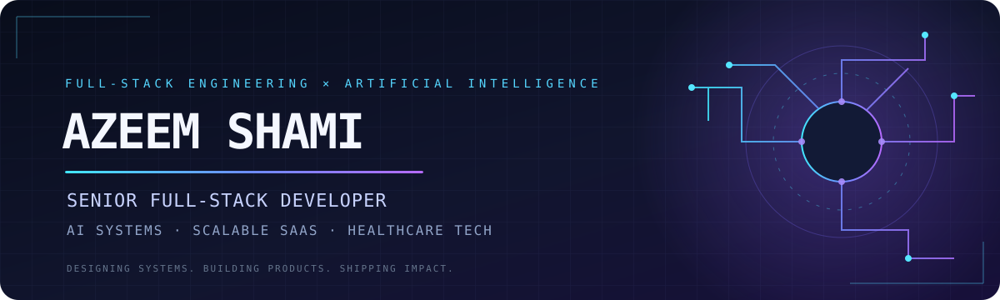

<div align="center">



<br/>

<a href="https://azeemshami.com"></a>
<a href="https://www.linkedin.com/in/muhammad-azeem-shami-8384b0114/"></a>
<a href="mailto:azeemshami222@gmail.com"></a>
<a href="https://github.com/azeemshami"></a>


<br/>


</div>

---

## `01 / THE ENGINEER`

I'm **Muhammad Azeem Shami** — a Senior Full-Stack Developer and AI Engineer with 8+ years of experience building SaaS products, AI-powered applications, and healthcare platforms.

I work across the stack: from designing backend systems and distributed architectures to shipping polished user experiences and integrating production LLM capabilities.

```text
BUILD  →  ARCHITECT  →  INTEGRATE  →  OPTIMIZE  →  SHIP
```

- **AI engineering:** multi-model integrations, LLM workflows, embeddings, prompt engineering, AI guardrails and model routing.
- **Backend systems:** Python, Node.js, NestJS, Django, FastAPI, REST, GraphQL and microservices.
- **Product engineering:** React, Next.js, Vue, TypeScript and modern UI systems.
- **Cloud & delivery:** AWS, Docker, Kubernetes, CI/CD and production operations.
- **Domain experience:** SaaS, healthcare / EHR, RCM, LegalTech, telecom and e-commerce.

## `02 / CORE TECHNOLOGY`

<div align="center">

### AI / LLM ENGINEERING

<br/>


### LANGUAGES & BACKEND


### FRONTEND


### DATA & INFRASTRUCTURE


</div>

<details>
<summary><b>More of my engineering toolkit</b></summary>
<br/>

**Architecture & APIs:** Microservices, GraphQL Federation, RESTful APIs, WebSockets, Socket.io, event-driven systems, serverless.

**Backend:** Django REST Framework, Flask, Node-RED, TypeORM, NestJS, Express, Laravel, CodeIgniter.

**Frontend:** React Remix, Zustand, Radix UI, shadcn/ui, Chakra UI, Redux Toolkit, Tailwind CSS, micro-frontends.

**Data & search:** PostgreSQL, MongoDB, MySQL, Redis, DynamoDB, OpenSearch, Kafka.

**Cloud & delivery:** AWS EC2, S3, Lambda, CloudFront, CloudWatch, Kubernetes, Docker, Vercel, GitHub Actions, CI/CD, Grafana.

**Integrations:** Stripe, PayPal, Availity, Agora SDK, WordPress plugins, Shopify apps.

</details>

## `03 / SELECTED BUILDS`

<div align="center">

<a href="https://robalaxtools.com">
  
</a>
<a href="https://pomomapai.com">
  
</a>

</div>

<table>
<tr>
<td width="50%" valign="top">

### ◈ Robalax Tools
**Developer utilities for everyday workflows.**

A collection of practical online tools designed to make common developer tasks faster and easier.

[**Explore robalaxtools.com ↗**](https://robalaxtools.com)

</td>
<td width="50%" valign="top">

### ◈ DrawingNotebook
**A digital space for drawing and notes.**

A personal product focused on an accessible online drawing and notebook experience.

[**Explore drawingnotebook.com ↗**](https://drawingnotebook.com)

</td>
</tr>
<tr>
<td width="50%" valign="top">

### ◈ PomoMapAI
**AI-assisted productivity.**

A productivity platform bringing together Pomodoro sessions, projects, tasks and AI planning.

[**Explore pomomapai.com ↗**](https://pomomapai.com)

</td>
<td width="50%" valign="top">

### ◈ AI Engine Service
**A multi-provider AI gateway.**

A backend service focused on provider adapters, intelligent model routing, fallback handling, reliability, throttling and usage metering.

[**Explore repository ↗**](https://github.com/azeemshami/ai-engine-service)

</td>
</tr>
<tr>
<td width="50%" valign="top">

### ◈ AI Connect
**Multi-model AI backend.**

Integrated OpenAI, Claude, Gemini and DeepSeek with intelligent routing, embeddings, throttling and Azure deployments.

</td>
<td width="50%" valign="top">

### ◈ Legal AI Assistant
**AI workflows for patent professionals.**

A multi-model legal assistant designed around domain-specific prompt engineering, research and drafting workflows.

</td>
</tr>
<tr>
<td width="50%" valign="top">

### ◈ Healthcare EHR Platform
**Healthcare workflows at scale.**

Contributed to EHR, patient portal, clinical documentation, Revenue Cycle Management and clearing-house integrations.

</td>
<td width="50%" valign="top">

### ◈ YouTube Transcriber
**Video-to-text API.**

A Python / FastAPI service that accepts YouTube URLs and produces text transcriptions.

</td>
</tr>
</table>

## `04 / IMPACT IN PRODUCTION`

<div align="center">

<table>
<tr>
<td align="center" width="25%">
<h2>90%</h2>
<sub>Faster clinical workflow load time</sub>
</td>
<td align="center" width="25%">
<h2>40%</h2>
<sub>Fewer user-reported issues</sub>
</td>
<td align="center" width="25%">
<h2>30%</h2>
<sub>AI accuracy improvement</sub>
</td>
<td align="center" width="25%">
<h2>6</h2>
<sub>Engineers led / mentored</sub>
</td>
</tr>
</table>

</div>

- Reduced a clinical documentation screen's load time from **5 minutes to 30 seconds**.
- Helped reduce user-reported issues by **40%** through improved feature integration.
- Improved legal AI model accuracy by **30%** through prompt engineering and evaluation.
- Reduced deployment time by **40%** through CI/CD pipeline improvements.
- Led engineering teams of up to **6 developers**.

## `05 / CERTIFICATIONS`

<div align="center">

<a href="https://coursera.org/share/c9d72c147ac5c66f991704d5f327f64c">
  
</a>
<a href="https://coursera.org/share/77b816ed69fdd82f2f7d01e287cdd29f">
  
</a>
<a href="https://www.coursera.org/account/accomplishments/verify/QMZNUV1470DS">
  
</a>

</div>

- **Google AI Professional Certificate** — Google · September 2026
- **Python for Data Science, AI & Development** — IBM · September 2026
- **Machine Learning with Python** — IBM · October 2026

## `06 / GITHUB SIGNAL`

<div align="center">


### Contribution graph


</div>

## `07 / CURRENTLY EXPLORING`

```yaml
ai_engineering:
  - LLM application architecture
  - RAG pipelines and evaluation
  - AI agents and tool orchestration
  - Multi-model inference and intelligent routing

software_engineering:
  - Distributed systems
  - Cloud-native architecture
  - Reliable and observable microservices
  - Scalable SaaS product design
```

---

<div align="center">


### HAVE AN INTERESTING PROBLEM? LET'S BUILD.

<a href="https://azeemshami.com">PORTFOLIO</a> &nbsp;·&nbsp;
<a href="https://www.linkedin.com/in/muhammad-azeem-shami-8384b0114/">LINKEDIN</a> &nbsp;·&nbsp;
<a href="mailto:azeemshami222@gmail.com">EMAIL</a>

<sub>Engineering ideas into reality — one commit at a time.</sub>

</div>
